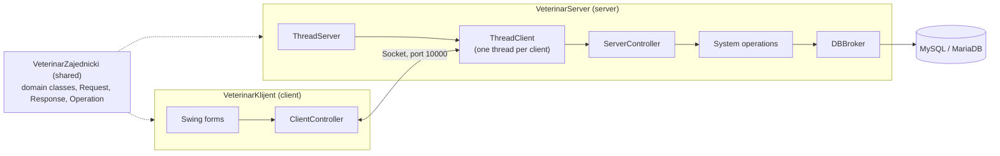
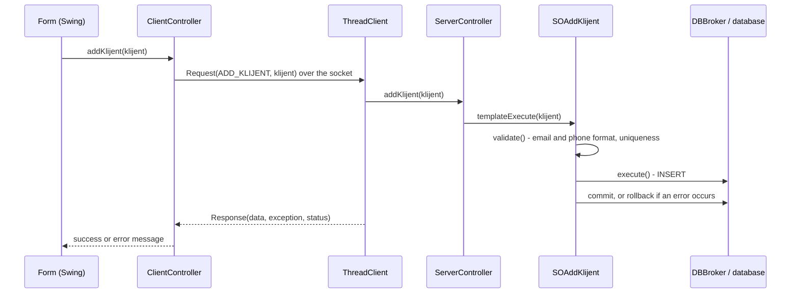
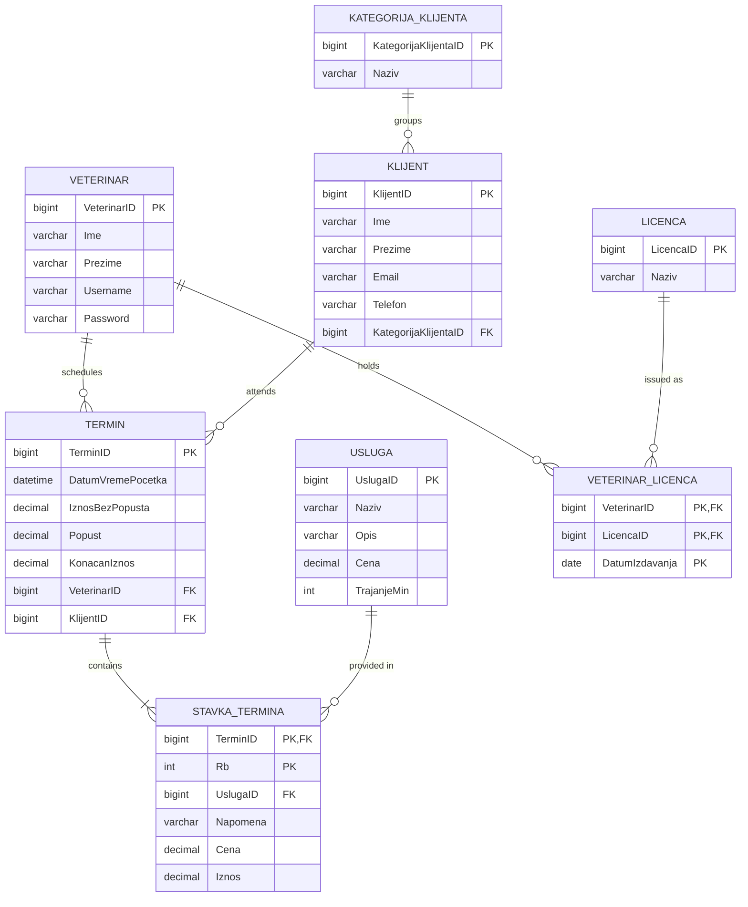

# 🐾 Software System for Managing Veterinary Services

**English** | [Srpski](README.sr.md)


A client-server desktop application in Java for managing veterinary services. Veterinarians use the client application to manage clients, services and appointments, while the server handles requests from multiple clients at the same time, communicates with the database and shows in real time who is logged in and how many appointments each veterinarian has.

## Contents

- [Features](#features)
- [Architecture](#architecture)
- [Request flow](#request-flow)
- [Database model](#database-model)
- [Business rules](#business-rules)
- [Design patterns](#design-patterns)
- [Project structure](#project-structure)
- [Getting started](#getting-started)
- [Documentation](#documentation)

## Features

### Client application

| Area | Capabilities |
|---|---|
| **Login** | veterinarian login and logout |
| **Appointments** | creating appointments with multiple items (services) and automatic calculation of the total and the discount based on the client category; search by client first and last name, veterinarian first and last name, service and date; viewing details, editing and deleting |
| **Clients** | creating, searching by first name, last name, email, phone and category, editing and deleting |
| **Services** | creating, searching by name, editing and deleting |
| **Client categories** | creating, searching by name, editing and deleting |

Search results are loaded from the database on every keystroke and refreshed automatically every 10 seconds.

Discount by client category:

| Category | Discount |
|---|---|
| Osnovni (Basic) | 0% |
| Srebrni (Silver) | 10% |
| Zlatni (Gold) | 20% |

### Server application

- starting and stopping the server
- editing the database configuration (database name, user, password) through a form
- a table of all veterinarians with their **Online / Offline** status and number of appointments (**total**, **upcoming**, **today**), refreshed every 3 seconds

## Architecture

The solution consists of three NetBeans (Ant) projects. The shared project contains the classes used by both the server and the client.



| Project | Role |
|---|---|
| `VeterinarZajednicki` | domain classes and transfer objects (`Request`, `Response`, `Operation`, `ResponseStatus`) |
| `VeterinarServer` | accepting clients, handling requests, system operations and database access |
| `VeterinarKlijent` | user interface, sending requests to the server and displaying results |

## Request flow

Example: a veterinarian adds a new client.



## Database model



Table and column names are in Serbian: *Veterinar* = veterinarian, *Klijent* = client, *KategorijaKlijenta* = client category, *Usluga* = service, *Termin* = appointment, *StavkaTermina* = appointment item, *Licenca* = license.

Appointment items have a composite primary key (`TerminID`, `Rb`) and are deleted together with their appointment (`ON DELETE CASCADE`).

## Business rules

| Rule | Enforced in |
|---|---|
| Email must be valid and the phone number must follow the `06XXXXXXXX` format | `SOAddKlijent`, `SOUpdateKlijent` |
| Email and phone number must be unique across clients | `SOAddKlijent`, `SOUpdateKlijent` |
| Service duration must be between 5 and 180 minutes and the price greater than 0 | `SOAddUsluga`, `SOUpdateUsluga` |
| Client category name must not be empty | `SOAddKategorijaKlijenta`, `SOUpdateKategorijaKlijenta` |
| An appointment must be scheduled in the future and have at least one item | `SOAddTermin`, `SOUpdateTermin` |
| The same service cannot be added twice to an appointment being created | client form for creating appointments |
| Past appointments can only be viewed, not edited or deleted | appointment details form |
| The same veterinarian cannot be logged in twice at the same time | `SOLogin` |
| A client with appointments, a service used in appointments and a category with clients cannot be deleted | foreign key constraints in the database |

## Design patterns

- **Template Method**: `AbstractSO.templateExecute()` runs the same sequence of steps for every system operation (`validate` → `execute` → `commit` / `rollback`), while each concrete operation implements only `validate` and `execute`.
- **Generic data access**: domain classes extend `AbstractDomainObject` and describe their own table, joins, columns and search conditions, so a single `DBBroker` builds `SELECT`, `INSERT`, `UPDATE` and `DELETE` queries for all entities.
- **Singleton**: `DBBroker`, `ServerController`, `ClientController` and `Session`.
- **Thread per client**: `ThreadServer` starts a separate `ThreadClient` for every new connection, so the server serves multiple veterinarians at the same time.
- **Request / Response**: all operations go through the same protocol, with an operation code from `Operation` and a response status (`Success` / `Error`).

## Project structure

```
veterinaryService/
├── VeterinarZajednicki/src
│   ├── domain/                 # domain classes and AbstractDomainObject
│   └── transfer/               # Request, Response, Operation, ResponseStatus
├── VeterinarServer/src
│   ├── controller/             # ServerController
│   ├── db/                     # DBBroker
│   ├── forms/                  # ServerForm, KonfiguracijaBaze
│   ├── models/                 # table model of logged-in veterinarians
│   ├── so/                     # system operations grouped by entity
│   └── thread/                 # ThreadServer, ThreadClient
├── VeterinarKlijent/src
│   ├── controller/             # ClientController
│   ├── forms/                  # LoginForm, MainForm (creating appointments)
│   ├── form_klijent/           # creating, searching and client details
│   ├── form_kategorija_klijenta/
│   ├── form_usluga/
│   ├── form_termin/            # appointment search and details
│   ├── models/                 # table models
│   └── session/                # Session (socket and logged-in veterinarian)
├── baza/veterinar.sql          # database creation with test data
└── dokumentacija/              # project documentation (PDF)
```

## Getting started

### Requirements

- JDK
- Apache NetBeans (Java with Ant)
- MySQL or MariaDB (developed with MariaDB 10.4)

### Steps

1. **Database**: run the script `baza/veterinar.sql` (e.g. in SQLyog or phpMyAdmin). It creates the `veterinar` database and fills it with test data.
2. **Configuration**: set `VeterinarServer/dbconfig.properties` (`url`, `username`, `password`), or after starting the server use the menu **Konfiguracija baze → Izmeni konfiguraciju**.
3. **Build**: in NetBeans, run **Clean and Build** in this order: `VeterinarZajednicki`, `VeterinarServer`, `VeterinarKlijent`. The server and the client use `VeterinarZajednicki/dist/VeterinarZajednicki.jar`.
4. **Server**: run `VeterinarServer` and click **Pokreni server** (Start server).
5. **Client**: run `VeterinarKlijent` (multiple instances can run at the same time) and log in.

### Test accounts

| Username | Password |
|---|---|
| `ni` | `ni` |
| `milica` | `milica` |
| `stefan` | `stefan` |
| `jovana` | `jovana` |

The appointments in the test data are from August and September 2026, so they are shown as finished in the details form. To try editing and deleting, create a new appointment with a future date.

The user interface and the documentation are in Serbian.

## Documentation

[`dokumentacija/Veterinar_dokumentacija.pdf`](dokumentacija/Veterinar_dokumentacija.pdf) (in Serbian) contains:

- requirements specification and use cases
- system operations, sequence diagrams and contracts
- conceptual (domain) and relational model
- design of the user interface, application logic and data storage