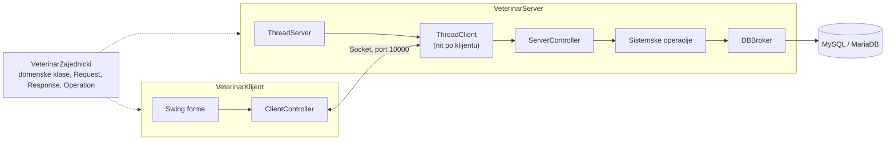
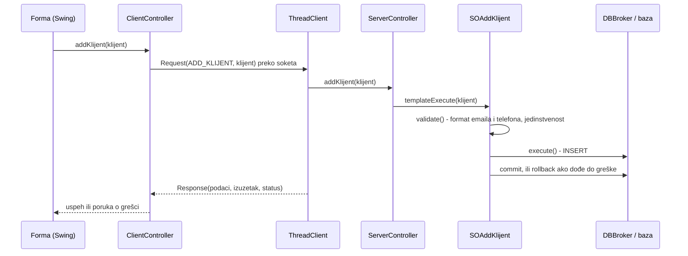
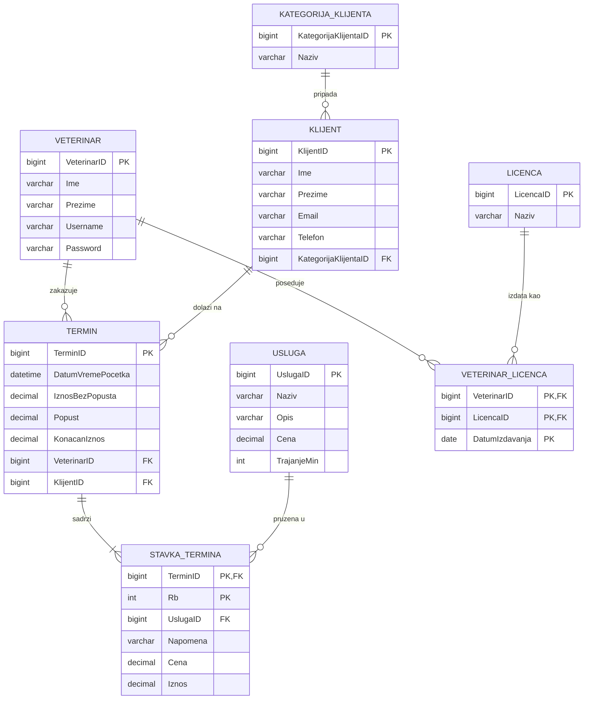

# 🐾 Softverski sistem za upravljanje veterinarskim uslugama

[English](README.md) | **Srpski**


Klijent-server desktop aplikacija u Java okruženju za upravljanje veterinarskim uslugama. Veterinari preko klijentske aplikacije vode evidenciju klijenata, usluga i termina, dok server obrađuje zahteve više klijenata istovremeno, komunicira sa bazom i u realnom vremenu prikazuje ko je prijavljen i koliko termina ima svaki veterinar.

## Sadržaj

- [Funkcionalnosti](#funkcionalnosti)
- [Arhitektura](#arhitektura)
- [Tok jednog zahteva](#tok-jednog-zahteva)
- [Model baze podataka](#model-baze-podataka)
- [Poslovna pravila](#poslovna-pravila)
- [Korišćeni obrasci](#korišćeni-obrasci)
- [Struktura projekta](#struktura-projekta)
- [Pokretanje](#pokretanje)
- [Dokumentacija](#dokumentacija)

## Funkcionalnosti

### Klijentska aplikacija

| Oblast | Mogućnosti |
|---|---|
| **Prijava** | prijava i odjava veterinara |
| **Termini** | unos termina sa više stavki (usluga), automatski obračun iznosa i popusta po kategoriji klijenta; pretraga po imenu i prezimenu klijenta, imenu i prezimenu veterinara, usluzi i datumu; pregled detalja, izmena i brisanje |
| **Klijenti** | unos, pretraga po imenu, prezimenu, emailu, telefonu i kategoriji, izmena i brisanje |
| **Usluge** | unos, pretraga po nazivu, izmena i brisanje |
| **Kategorije klijenata** | unos, pretraga po nazivu, izmena i brisanje |

Rezultati pretrage se dobijaju iz baze pri svakom unosu znaka i automatski osvežavaju na svakih 10 sekundi.

Popust po kategoriji klijenta:

| Kategorija | Popust |
|---|---|
| Osnovni | 0% |
| Srebrni | 10% |
| Zlatni | 20% |

### Serverska aplikacija

- pokretanje i gašenje servera
- izmena konfiguracije baze (naziv baze, korisnik, lozinka) kroz formu
- tabela svih veterinara sa statusom **Online / Offline** i brojem termina (**ukupno**, **budući**, **današnji**), koja se osvežava na svake 3 sekunde

## Arhitektura

Rešenje se sastoji od tri NetBeans (Ant) projekta. Zajednički projekat sadrži klase koje koriste i server i klijent.



| Projekat | Uloga |
|---|---|
| `VeterinarZajednicki` | domenske klase i transfer objekti (`Request`, `Response`, `Operation`, `ResponseStatus`) |
| `VeterinarServer` | prihvatanje klijenata, obrada zahteva, sistemske operacije i pristup bazi |
| `VeterinarKlijent` | korisnički interfejs, slanje zahteva serveru i prikaz rezultata |

## Tok jednog zahteva

Primer: veterinar dodaje novog klijenta.



## Model baze podataka



Stavke termina imaju složeni primarni ključ (`TerminID`, `Rb`) i brišu se zajedno sa terminom (`ON DELETE CASCADE`).

## Poslovna pravila

| Pravilo | Gde se proverava |
|---|---|
| Email mora biti u ispravnom formatu, a telefon u formatu `06XXXXXXXX` | `SOAddKlijent`, `SOUpdateKlijent` |
| Email i telefon moraju biti jedinstveni među klijentima | `SOAddKlijent`, `SOUpdateKlijent` |
| Trajanje usluge mora biti između 5 i 180 minuta, a cena veća od 0 | `SOAddUsluga`, `SOUpdateUsluga` |
| Naziv kategorije klijenta ne sme biti prazan | `SOAddKategorijaKlijenta`, `SOUpdateKategorijaKlijenta` |
| Termin mora biti zakazan u budućnosti i imati bar jednu stavku | `SOAddTermin`, `SOUpdateTermin` |
| Ista usluga ne može se dva puta dodati u termin koji se unosi | klijentska forma za unos termina |
| Završeni termini mogu samo da se pregledaju, ne i menjaju ili brišu | forma za detalje termina |
| Isti veterinar ne može biti prijavljen dva puta istovremeno | `SOLogin` |
| Ne mogu se obrisati klijent koji ima termine, usluga koja je korišćena u terminima i kategorija koja ima klijente | ograničenja stranih ključeva u bazi |

## Korišćeni obrasci

- **Template Method**: `AbstractSO.templateExecute()` za svaku sistemsku operaciju izvršava isti niz koraka (`validate` → `execute` → `commit` / `rollback`), dok konkretne operacije implementiraju samo `validate` i `execute`.
- **Generički pristup bazi**: domenske klase nasleđuju `AbstractDomainObject` i same opisuju svoju tabelu, spojeve, kolone i uslove pretrage, pa jedan `DBBroker` sastavlja `SELECT`, `INSERT`, `UPDATE` i `DELETE` upite za sve entitete.
- **Singleton**: `DBBroker`, `ServerController`, `ClientController` i `Session`.
- **Nit po klijentu**: `ThreadServer` za svaku novu konekciju pokreće zaseban `ThreadClient`, pa server istovremeno opslužuje više veterinara.
- **Request / Response**: sve operacije prolaze kroz isti protokol, sa šifrom operacije iz `Operation` i statusom odgovora (`Success` / `Error`).

## Struktura projekta

```
veterinaryService/
├── VeterinarZajednicki/src
│   ├── domain/                 # domenske klase i AbstractDomainObject
│   └── transfer/               # Request, Response, Operation, ResponseStatus
├── VeterinarServer/src
│   ├── controller/             # ServerController
│   ├── db/                     # DBBroker
│   ├── forms/                  # ServerForm, KonfiguracijaBaze
│   ├── models/                 # model tabele ulogovanih veterinara
│   ├── so/                     # sistemske operacije po entitetima
│   └── thread/                 # ThreadServer, ThreadClient
├── VeterinarKlijent/src
│   ├── controller/             # ClientController
│   ├── forms/                  # LoginForm, MainForm (unos termina)
│   ├── form_klijent/           # unos, pretraga i detalji klijenta
│   ├── form_kategorija_klijenta/
│   ├── form_usluga/
│   ├── form_termin/            # pretraga i detalji termina
│   ├── models/                 # modeli tabela
│   └── session/                # Session (socket i ulogovani veterinar)
├── baza/veterinar.sql          # kreiranje baze sa test podacima
└── dokumentacija/              # projektna dokumentacija (PDF)
```

## Pokretanje

### Potrebno

- JDK
- Apache NetBeans (Java with Ant)
- MySQL ili MariaDB (projekat je razvijan uz MariaDB 10.4)

### Koraci

1. **Baza**: izvrši skriptu `baza/veterinar.sql` (npr. u SQLyog-u ili phpMyAdmin-u). Skripta pravi bazu `veterinar` i puni je test podacima.
2. **Konfiguracija**: podesi `VeterinarServer/dbconfig.properties` (`url`, `username`, `password`), ili posle pokretanja servera kroz meni **Konfiguracija baze → Izmeni konfiguraciju**.
3. **Build**: u NetBeans-u uradi **Clean and Build** redom: `VeterinarZajednicki`, `VeterinarServer`, `VeterinarKlijent`. Server i klijent koriste `VeterinarZajednicki/dist/VeterinarZajednicki.jar`.
4. **Server**: pokreni `VeterinarServer` i klikni **Pokreni server**.
5. **Klijent**: pokreni `VeterinarKlijent` (može i više instanci istovremeno) i prijavi se.

### Test nalozi

| Korisničko ime | Lozinka |
|---|---|
| `ni` | `ni` |
| `milica` | `milica` |
| `stefan` | `stefan` |
| `jovana` | `jovana` |

Termini u test podacima su iz avgusta i septembra 2026, pa se u detaljima prikazuju kao završeni. Za proveru izmene i brisanja napravi novi termin sa datumom u budućnosti.

## Dokumentacija

[`dokumentacija/Veterinar_dokumentacija.pdf`](dokumentacija/Veterinar_dokumentacija.pdf) sadrži:

- specifikaciju zahteva i slučajeve korišćenja
- sistemske operacije, sekvencne dijagrame i ugovore
- konceptualni (domenski) i relacioni model
- projektovanje korisničkog interfejsa, aplikacione logike i skladišta podataka